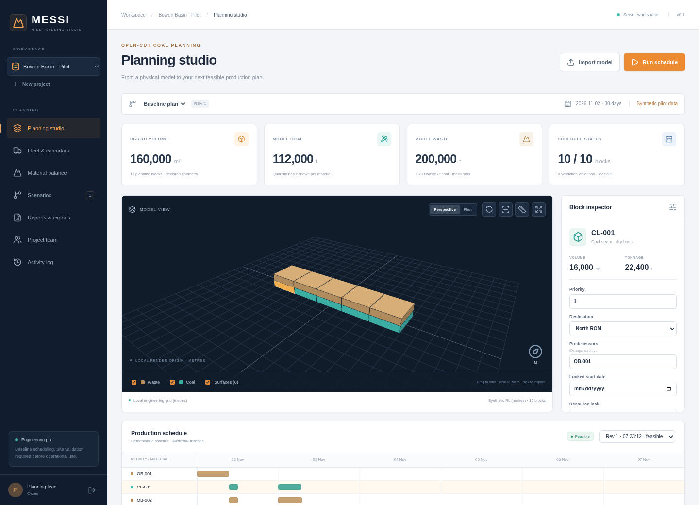

# MESSI · Mine Planning Studio

An independent **browser-based open-cut coal planning application**. Import a physical model, inspect it in 3D, configure fleets and calendars, generate a feasible production schedule and export reconciled results.

**Release 0.1 is a working engineering pilot.** It is not the complete mature suite described in the long-term blueprint, a verified SPRY equivalent, a geological estimator or an operationally approved mine plan. Review the [implementation/support matrix](docs/IMPLEMENTATION.md) before using it.

## What works

- Authenticated team projects with owner/planner/reviewer/viewer permissions.
- Validated block CSV import, metres/feet conversion, explicit density and mass/quality bases, original-source retention and hashes.
- Triangulated OBJ reference-surface import with topology checks; viewing only, without derived solid-volume claims.
- Interactive Three.js 3D blocks/surfaces: orbit, plan view, selection, layers, cross-section, block-origin measurements and geometry editing.
- Coal/waste quantities, predecessors, priorities, manual date/resource locks, equipment rates, utilisation, working days and maintenance dates.
- Deterministic server-side scheduling with exclusive resource allocation, precedence, calendars, destination limits and independent result validation.
- Gantt inspection and date-based 3D extraction playback.
- Destination opening/receipts/closing mass balance and compatible-basis weighted coal ash.
- Scenario branches, immutable run snapshots, stale-result warnings and multi-user revision conflicts.
- Durable background jobs, cancellation, abandoned-lease recovery and idempotent submissions.
- CSV, Excel, PDF and JSON exports; run approval and project audit history.
- SQLite zero-service local development and PostgreSQL deployment support, with tested private backup/fresh restore.



## Quick start

Native server development uses Linux/WSL. Requirements: **Node.js 22.12+** (tested 24.19), **Python 3.12**, and **uv**. Docker is optional for the PostgreSQL/container route. No Python or Node installation is required on browser clients.

```bash
git clone https://github.com/massababrar3-cmd/MESSI-.git
cd MESSI-
npm run setup
npm run dev
```

On your own development computer, open the browser at `127.0.0.1:5173`. The API listens on loopback port 8000; Vite proxies `/api` so cookies and CSRF protection remain same-origin. The API and planning worker must both be running; `npm run dev` manages them together. Ctrl+C stops only these processes.

Setup creates independent random pilot passwords in **`.local/bootstrap-users.json`** with restrictive file permissions. Open it privately in your editor. Do not paste it into chat, issues or commits. Three synthetic accounts are provided: owner, planner and viewer. The owner has an explicit owner membership on the sample project. Accounts are not shared factory credentials. Repeating setup preserves existing accounts and project data.

Choose the **Bowen Basin · Pilot** synthetic project, inspect a block and press **Run schedule**. Its 10 synthetic blocks contain **160,000 m³**, **112,000 t coal**, and **200,000 t waste**, on the declared dry basis. No survey validity or coal density calibration is implied. You can instead create a blank project and import [the analytic 10-block CSV](examples/ten-blocks.csv) or [a reference surface](examples/reference-surface.obj).

To serve compiled assets without Vite:

```bash
npm run build
npm start
```

This serves the built SPA on loopback port 8000 with the API and worker. The script's `--production` flag means “serve built assets”; it does not by itself configure enterprise identity, public HTTPS or production approval.

## Verification

```bash
npm test
npm run typecheck
npm run build
npm run test:e2e
npm run backup
npm run smoke
```

The smoke check creates a separate synthetic project and verifies a real background run/export. Browser tests require the already-running application and `/usr/bin/chromium` (or `CHROMIUM_PATH`). They use privately generated accounts and create clearly named fictitious projects. Do not point the test suite at a production mine project. When using `npm start`, set `MESSI_E2E_URL=http://127.0.0.1:8000` for browser tests (default dev port is 5173). See [validation evidence](docs/VALIDATION.md) for actual outcomes and untested targets.

Python dependencies are fully pinned with hashes in `backend/requirements.txt`; JavaScript dependencies use `package-lock.json`. `requirements.in` contains direct requirements. Use `uv pip compile ... --generate-hashes` to deliberately refresh the Python lock, followed by the test suites and dependency review.

## Deployment and operation

- [Setup and server operations](docs/OPERATIONS.md): PostgreSQL, containers, identity, users, backup/restore and environment variables.
- [Engineering contracts](docs/ENGINEERING.md): formulas, coordinates, quality, calendar and scheduling semantics.
- [Architecture decisions](docs/ARCHITECTURE.md): implemented architecture and deliberate differences from the long-term proposal.
- [Implemented/deferred requirements](docs/IMPLEMENTATION.md): stable FR IDs and next milestones.
- [Original blueprint/SRS](docs/BLUEPRINT.md) and [master prompt](docs/MASTER-PROMPT.md): proposed long-term scope, not a completed-feature checklist.

The repository contains code and synthetic examples only. Runtime mine models, generated passwords, database files, logs and private backups belong under ignored `.local/` or approved server storage. Existing unrelated repositories are not modified by this application.
